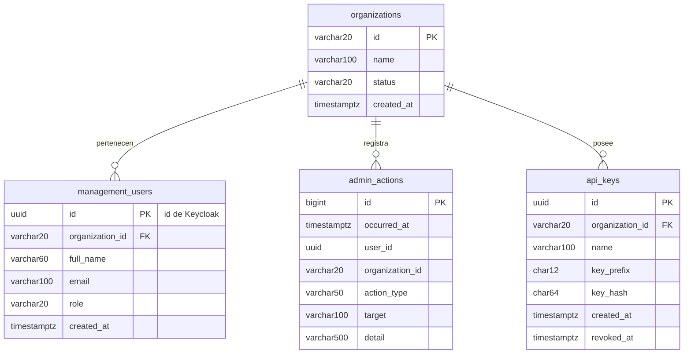
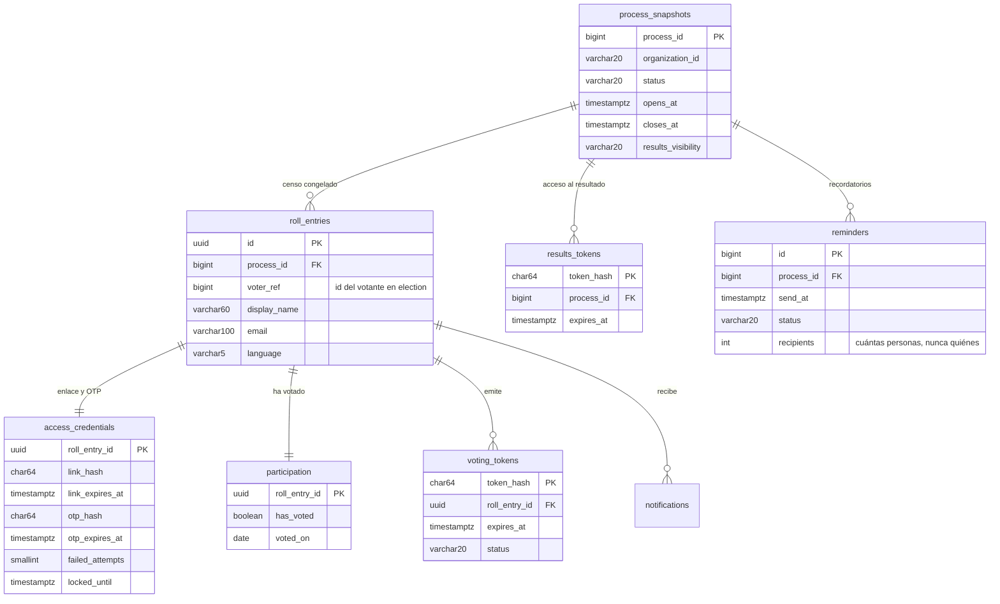
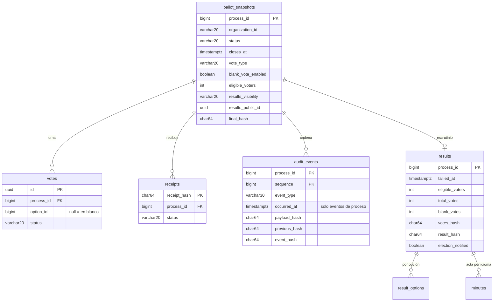

# Modelo de datos por servicio

Fuente: requisitos de información RI-1 a RI-13 (`especificacion_detallada.tex`) y decisiones de
`docs/ai/DECISIONS.md`. Las desviaciones respecto al TFM se marcan con **Desviación** y su decisión.

## 1. Convenciones

- PostgreSQL 18.6, una base de datos por servicio (D-08). Esquema gestionado con Flyway.
- `organization_id` = identificador de organización de RI-1 (`VARCHAR(20)`, alfanumérico). Lo llevan todas
  las tablas de negocio y lo publica el JWT de Keycloak en el claim `organization_id` (D-17).
- Claves técnicas `BIGINT GENERATED ALWAYS AS IDENTITY`, salvo donde un identificador secuencial
  revelaría orden (urna, participación): ahí `UUID` aleatorio (`gen_random_uuid()`).
- Fechas en `TIMESTAMPTZ` (UTC). Textos con la longitud máxima de RI-x como `VARCHAR(n)` + `CHECK`.
- Enumerados como `VARCHAR` + `CHECK`, en inglés y mayúsculas.
- Ningún secreto se guarda en claro: enlaces, OTP, tokens de voto, recibos y claves de API se guardan
  como SHA-256 en hexadecimal (`CHAR(64)`).

## 2. identity-service · `identity_db` (pg-main)



| Tabla | RI | Notas |
| --- | --- | --- |
| `organizations` | RI-1 | Creada como `tenants` en V1 y renombrada en V2 (columna `identifier` → `id`). |
| `management_users` | RI-2 | **Desviación (D-02, D-25):** contraseña, segundo factor, estado y último acceso viven en Keycloak. Aquí se guarda una copia de organización, nombre, correo y rol para listar usuarios, aplicar la regla del último administrador y atender RF-18 sin consultar Keycloak. El Superadministrador no tiene fila (pertenece a la plataforma). Correo único sin distinguir mayúsculas. |
| `admin_actions` (V4) | RI-13 | Trazabilidad (RF-19, D-44): `event_id` único (idempotencia), organización, momento, persona (`actor_id`, `actor_name`), acción, objeto (tipo, id, nombre), detalle, proceso y origen (`IDENTITY`, `ELECTION`, `BALLOT_BOX`). **Solo añadir:** disparadores que rechazan `UPDATE`, `DELETE` y `TRUNCATE`. Nunca el nombre ni el correo de una persona del censo. |
| `admin_actions` | RI-13 | Solo inserción: el rol `identity` no tiene `UPDATE` ni `DELETE`, y un *trigger* rechaza ambas operaciones. |
| `api_keys` | RF-21 (P6) | Solo se guarda el hash; la clave se muestra una vez al crearla. |

**Trazabilidad administrativa (RF-19).** Cada servicio registra sus acciones administrativas en su propia
tabla `admin_actions`, en la misma transacción que la acción, para no perder registros si otro servicio no
responde. La consulta de RF-19 la agrega `identity-service` (D-19).

## 3. election-service · `election_db` (pg-main)

```mermaid
erDiagram
    censuses ||--o{ voters : "contiene"
    censuses ||--o{ processes : "participa en"
    processes ||--|| ballots : "tiene"
    ballots ||--o{ ballot_texts : "traducciones"
    ballots ||--o{ ballot_options : "opciones"
    ballot_options ||--o{ ballot_option_texts : "traducciones"
    processes ||--o{ process_status_changes : "historial"
    processes ||--o{ process_sync : "pendiente de propagar"
    censuses {
        bigint id PK
        varchar20 organization_id
        varchar100 name
        timestamptz created_at
    }
    voters {
        bigint id PK
        varchar20 organization_id
        bigint census_id FK
        varchar60 full_name
        varchar100 email
        varchar15 phone
        varchar50 institutional_id
        varchar5 preferred_language
        timestamptz anonymized_at
    }
    processes {
        bigint id PK
        varchar20 organization_id
        bigint census_id FK
        timestamptz opens_at
        timestamptz closes_at
        varchar20 status
        varchar5 default_language
        varchar20 results_visibility
        uuid results_public_id
    }
    ballots {
        bigint process_id PK
        varchar20 vote_type
        boolean blank_vote_enabled
    }
    ballot_options {
        bigint id PK
        bigint process_id FK
        int position
    }
```



| Tabla | RI | Notas |
| --- | --- | --- |
| `censuses`, `voters` | RI-3 | Duplicados por censo: `UNIQUE (census_id, lower(email))` y `UNIQUE (census_id, institutional_id)` si no es nulo. RF-18 (D-46): `anonymized_at` marca una entrada anonimizada («Persona anonimizada», correo `anonimizada-{id}@anonimizada.invalid`, sin teléfono ni identificador); no se edita ni entra en nuevos censos congelados. |
| `processes` | RI-4 | `CHECK (closes_at > opens_at)`. Estados: `DRAFT`, `SCHEDULED`, `OPEN`, `CLOSED`, `TALLIED`, `ARCHIVED`. **Desviación (D-03):** sin «re-votación permitida». Título y descripción de cada idioma en `process_texts` (process_id, language, title, description); el idioma por defecto siempre está (D-29). |
| `processes.results_visibility` | RF-13, RF-15 | `CENSUS_ONLY` (por defecto) o `PUBLIC_LINK` (D-16). `results_public_id` es un UUID aleatorio que forma el enlace público. |
| `ballots`, `ballot_texts`, `ballot_options`, `ballot_option_texts` | RI-5, RF-20 | `vote_type`: `SINGLE_CHOICE` o `YES_NO_ABSTAIN` (opciones fijas generadas). Pregunta 300 y opción 200 caracteres; entre 2 y 50 opciones; `UNIQUE (process_id, position)` diferida. En borrador basta el idioma por defecto; `es` y `en` se exigen al programar (D-29). |
| `process_status_changes` | RF-07, RF-19 | Quién (usuario o `SYSTEM`), cuándo y qué transición. |
| `process_sync` | — | *Outbox* (D-30): destino (`VOTER_ACCESS`, `BALLOT_BOX`), tipo (`SNAPSHOT`, `STATUS`, `ANONYMIZE` desde V5, D-46), `payload` JSON (se borra al entregar), estado (`PENDING`, `DELIVERED`, `FAILED`), intentos y próximo intento. Entrega en orden por proceso y destino. |
| `admin_action_outbox` (V4) | RI-13 | Acciones administrativas pendientes de entregar a identity (D-44); la fila se borra cuando identity la acepta. |

**Congelación del censo.** **Desviación:** el censo se congela desde `SCHEDULED`, no desde `OPEN`, porque RF-17
envía las invitaciones con el enlace personal al programar el proceso. Al programar, election envía a voter-access la
instantánea del censo y a ballot-box la papeleta.

## 4. voter-access-service · `voter_access_db` (pg-main)



| Tabla | RI | Notas |
| --- | --- | --- |
| `process_snapshots` (+ `process_snapshot_texts`) | RI-4 | Copia mínima para validar enlaces y mostrar título, estado y cierre (pantallas V1, C3, V4). |
| `roll_entries` | RI-3, RI-12 | Instantánea del censo congelado: solo los datos necesarios para avisar (RNF-16). `id` UUID aleatorio. |
| `access_credentials` | RI-12 | Enlace de 64 caracteres y OTP de 6 dígitos guardados como hash SHA-256 (`VARCHAR(64)`). El enlace se genera al enviar la invitación. Límites de envío del código y bloqueo temporal tras 5 fallos (RNF-14, D-31). |
| `participation` | RI-7 | **Desviación (D-18):** sin hora del voto, solo `voted_on` (día). La pantalla «Ya has votado» muestra la fecha sin hora. Canal implícito: en línea. |
| `voting_tokens` | — | Token de voto de un solo uso (hash): `ISSUED` → `CONSUMED` (o `REVERTED`, que admite reintento); `REVOKED` si se emite otro. Caducidad 15 min (D-31). |
| `results_tokens` (V2) | RF-15 | Acceso al resultado tras el escrutinio (D-41): hash del token, proceso y caducidad (30 min). **Sin `roll_entry_id`:** no dice qué persona del censo lo pidió. Reutilizable mientras vale; ballot-box no guarda nada de él. |
| `notifications` | RI-11 | Tipo `INVITATION`, `REMINDER`, `CLOSING`; canal `EMAIL`; estado `PENDING`, `DELIVERED`, `FAILED` o `CANCELLED` (V3: no necesario, la persona ya había votado o la votación terminó); hasta 9 intentos con espera creciente (`next_attempt_at`). Nunca incluyen la opción votada. **Desviación (D-45):** sin `notification_templates`; textos fijos en español e inglés (plantillas editables en IMP-22). |
| `reminders` (V3) | RF-17 | Recordatorios del ADMIN: `SCHEDULED` → `SENT` (con `recipients`, solo el número) o `CANCELLED`; máximo 5 activos por proceso (D-45). |
| `admin_action_outbox` (V3) | RF-19 | Acciones administrativas pendientes de entregar a identity (como en election y la urna, D-44). |

## 5. ballot-box-service · `ballot_box_db` (pg-ballot)



| Tabla | RI | Notas |
| --- | --- | --- |
| `ballot_snapshots` (+ textos, opciones y `ballot_titles`) | RI-4, RI-5 | Copia de la papeleta recibida al programar. Sirve para mostrar y validar la selección y para escrutar. `ballot_titles` (V4): título del proceso por idioma, solo para el acta; no forma parte de la papeleta canónica (D-40). |
| `votes` | RI-6 | `id` UUID aleatorio, sin identidad, sin token, sin recibo. Estado `COUNTABLE` (`SUBSTITUTED` reservado para RF-11). **Desviación (D-18):** sin fecha y hora de recepción ni canal. |
| `receipts` | RI-8 | Hash del código de 64 hex. Sin vínculo con el voto ni con la identidad. Estado `VALID`. **Desviación (D-18):** sin hora de emisión. |
| `audit_events` | RI-9 | Tipos: `OPENED`, `VOTE_RECEIVED`, `CLOSED`, `FINAL_HASH_PUBLISHED`. **Desviación (D-18):** `occurred_at` solo en eventos de proceso; los de voto no llevan hora. `payload_hash` de un voto = SHA-256 del hash del recibo. |
| `results`, `result_options`, `minutes` | RI-10 | Votos por opción y en blanco, censo, huella de la lista de votos y del resultado (D-37); porcentajes y participación (2 decimales) se calculan al leer. `election_notified`: election ya pasó el proceso a `TALLIED`. Acta PDF (`minutes`, V4): `process_id`, `language`, `generated_at`, `sha256`, `pdf`; se escribe una vez por idioma y no cambia (D-40). |
| `incidents` (`REVERT_FAILED`, `CHAIN_BROKEN`, `TALLY_FAILED`, `PARTICIPATION_MISMATCH`) | RF-12, RF-13 | Cadena rota, recuento no publicado o total de la urna distinto del número de personas que votaron (V5, D-43); solo el día (D-18), una por proceso y tipo. Sustituye a `tally_incidents`. |
| `chain_checks` | RF-12 | Última verificación de la cadena de cada proceso: momento, resultado, eventos comprobados, huella final y hasta 100 problemas `CÓDIGO@secuencia`. Sin usuario (la trazabilidad de acciones es RF-19). D-38. |
| `admin_action_outbox` (V6) | RI-13 | Verificaciones de la cadena, exportaciones y descargas del acta pendientes de entregar a identity (D-44). Solo acciones de gestión, nada sobre votos. |

**Cadena de auditoría (RF-12, RNF-13).**

```
event_hash = SHA-256( process_id | sequence | event_type | occurred_at o "" | payload_hash | previous_hash )
previous_hash del primer evento = 64 ceros
huella final = event_hash del evento CLOSED
```

Los eventos se añaden con la fila de `ballot_snapshots` bloqueada (`SELECT … FOR UPDATE`), lo que serializa
la secuencia por proceso. Cada voto es una transacción corta; su impacto en RNF-17 se mide en P7.

## 6. Separación de secreto (RNF-11)

### 6.1 Qué no puede coexistir

| Dato | Dónde vive | Nunca junto a |
| --- | --- | --- |
| Identidad del votante (nombre, correo, `voter_ref`, enlace, OTP) | `election_db`, `voter_access_db` | Opción votada, recibo |
| Opción votada | `ballot_box_db.votes` | Identidad, token, recibo, hora |
| Recibo | Solo lo conoce el votante; `ballot_box_db.receipts` guarda su hash | Identidad, opción |
| Token de voto | `voter_access_db.voting_tokens` (hash) | Nunca se guarda en `ballot_box_db` ni en logs |

Ningún rol de base de datos tiene acceso a `pg-main` y `pg-ballot` a la vez.

### 6.2 Emisión del voto y consistencia (RF-09, RNF-12)

1. Tras validar enlace y OTP, voter-access emite un token de voto aleatorio de un solo uso y corta duración.
   Solo acredita elegibilidad: no contiene identidad ni opción.
2. El votante envía a ballot-box el token y su selección. Ballot-box valida la selección y que el proceso
   está abierto (estado y `closes_at`).
3. Ballot-box pide a voter-access que consuma el token. En una sola transacción, voter-access comprueba que el
   token está `ISSUED`, no caducado, del mismo proceso y que el votante no ha votado; lo marca `CONSUMED` y
   pone `has_voted = true`, `voted_on = hoy`. Una segunda petición con el mismo token recibe 409.
4. Ballot-box, en una transacción con el proceso bloqueado, vuelve a comprobar que sigue abierto, inserta el
   voto, genera el recibo (64 hex aleatorios), guarda su hash y añade el evento `VOTE_RECEIVED`.
5. Si el paso 4 falla, ballot-box pide a voter-access revertir el consumo (`REVERTED`, `has_voted = false`).
   Si la reversión también falla, se registra una incidencia sin el token. Riesgo aceptado: votante marcado
   como votante sin voto en la urna; nunca un voto duplicado.

Ballot-box no guarda nada derivado del token, así que no puede enlazar el voto con la fila de voter-access.

### 6.3 Tiempo y orden (D-18)

- La urna no guarda la hora de ningún voto, recibo ni evento de voto.
- La participación guarda solo el día del voto.
- Votos y filas de participación usan UUID aleatorios: los identificadores no revelan orden.
- La secuencia de la cadena sí ordena los votos, pero no hay en voter-access un orden comparable salvo el día.

### 6.4 Lo que el sistema NO garantiza (riesgos residuales declarados)

- Un administrador con acceso físico a ambas bases de datos podría intentar correlacionar por orden físico de
  escritura en disco o por registros WAL. Mitigación: instancias y credenciales separadas; no se elimina.
- Quien observe en tiempo real el tráfico de ambos servicios puede correlacionar por tiempo.
- Cliente comprometido y coacción quedan fuera del alcance (TFM, sección 3.4).
- El recibo demuestra presencia en la urna, no que el voto registrado sea el emitido (no es *cast-as-intended*).
- Análisis completo de amenazas, defensas y riesgos: [`threat-model.md`](threat-model.md) (D-42).

## 7. Resultados (RF-13, RF-15, D-16)

- La huella final y la huella del resultado son públicas siempre: no revelan identidad ni votos individuales.
- El resultado se publica según `results_visibility` del proceso:
  - `CENSUS_ONLY`: el votante entra con su enlace personal y OTP (voter-access) para verlo.
  - `PUBLIC_LINK`: cualquiera con el enlace que contiene `results_public_id`.
- Verificación del resultado: ballot-box publica la lista de opciones contabilizadas sin orden ni recibos
  (permite recalcular el recuento) y la huella del resultado sobre su representación canónica.
