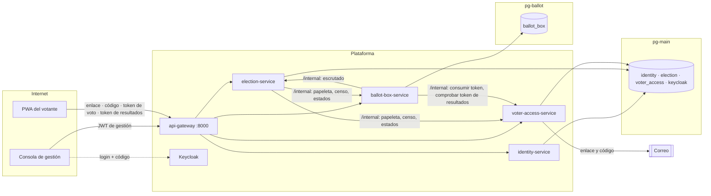

# Modelo de amenazas · VeriVoto

Estado: P5.6 (2026-10-30), sobre el código de `dev` + P5.5; actualizado en P5.7 con el endurecimiento aplicado (D-43). Método: STRIDE por elemento del diagrama de flujo de
datos, con adversarios explícitos. Cada defensa citada existe en el código; la columna «Evidencia» indica la prueba
que la comprobó (pruebas de extremo a extremo y de navegador ejecutadas durante el desarrollo, no versionadas hasta
`ACTIVAR TESTS`) o la sonda de esta revisión (§6). Decisión: D-42.

## 1. Alcance y supuestos

**Dentro:** la rebanada de voto (RF-06–RF-10), auditoría, escrutinio y resultados (RF-12–RF-16), la consola de
gestión y el aislamiento entre organizaciones (RNF-15). Propiedades: secreto del voto (RNF-11), unicidad (RNF-12),
integridad y trazabilidad (RNF-13), seguridad de acceso (RNF-14), protección de datos (RNF-16).

**Fuera (sección «Delimitación: qué no es este TFM» de la memoria y ADR-0007):** coacción y compra de votos, malware en el
dispositivo del votante, verificabilidad de extremo a extremo y *cast-as-intended*, anonimato frente a un adversario
que controla toda la infraestructura, ataques de disponibilidad a gran escala. Se nombran en §7 para no ocultarlos.

**Supuestos de despliegue:** TLS en todo el tráfico externo (Keycloak con `sslRequired = external`), solo el gateway
expuesto a Internet, secretos fuera del repositorio (`infra/.env`), una instancia por servicio, Keycloak en modo
producción (no `start-dev`).

## 2. Activos

| Activo | Propiedad | Dónde vive |
| --- | --- | --- |
| Opción votada | Secreto (no se une a la identidad) | `ballot_box_db.votes` (pg-ballot) |
| Identidad y participación | Confidencialidad; solo el día del voto (D-18) | `election_db`, `voter_access_db` (pg-main) |
| Credenciales del votante: enlace (384 bits), código de 6 cifras, token de voto y de resultados (256 bits), recibo (256 bits) | Solo su titular; se guardan como hash | `voter_access_db`, `ballot_box_db.receipts` |
| Urna, cadena de eventos, huella final y del resultado | Integridad, verificable por terceros | `ballot_box_db` |
| Resultado y acta | Integridad; visibilidad según `CENSUS_ONLY` / `PUBLIC_LINK` (D-16) | `ballot_box_db.results`, `minutes` |
| Datos de cada organización (censos, procesos, papeletas) | Aislamiento (RNF-15) | todos |
| Credenciales de gestión y de servicio | Confidencialidad | Keycloak |
| Periodo de votación | Disponibilidad | gateway, voter-access, ballot-box |

## 3. Adversarios

| ID | Adversario | Capacidad supuesta |
| --- | --- | --- |
| A1 | Externo anónimo | Llama a la API pública por Internet |
| A2 | Votante malicioso | Tiene su enlace y su correo; intenta votar dos veces o ver lo que no debe |
| A3 | Quien obtiene el enlace o el buzón de otra persona | Correo reenviado, historial, dispositivo prestado, buzón comprometido |
| A4 | Gestor malicioso de una organización (ADMIN, gestor de censo, auditor) | Usa la consola con sus roles |
| A5 | Gestor de otra organización | Usuario válido de un *tenant* distinto |
| A6 | Servicio comprometido | Secreto o ejecución de un servicio (p. ej. identity-service) |
| A7 | Operador de la plataforma | Acceso a una base de datos o a la infraestructura |
| A8 | Observador de red | Ve el tráfico (mitigado por TLS) o los tiempos |

## 4. Flujo de datos y fronteras de confianza

Fronteras: (F1) Internet ↔ gateway; (F2) gateway ↔ servicios (cada servicio valida el JWT); (F3) llamadas
`/internal/**` entre servicios con rol `SERVICE`, nunca enrutadas por el gateway; (F4) pg-main ↔ pg-ballot: instancias,
roles y credenciales distintos, ningún rol de base de datos llega a las dos; (F5) el correo, canal externo del votante.

## 5. Amenazas (STRIDE)

Riesgo residual = probabilidad × impacto con las defensas actuales (Bajo, Medio, Alto). En negrita, los hallazgos de
esta revisión.

| ID | STRIDE | Elemento | Amenaza (adversario) | Defensas actuales | Evidencia | Residual | Acción |
| --- | --- | --- | --- | --- | --- | --- | --- |
| T-01 | S | Enlace personal | Vota por otro quien tiene su enlace (A3) | Código de 6 cifras al correo del censo, 10 min, un solo uso; 5 fallos → bloqueo 15 min; 5 códigos cada 15 min (D-31); enlace solo como hash | e2e43 (423), e2e55 (400 con intentos) | Bajo | — |
| T-02 | S | Buzón del votante | Enlace y código llegan **al mismo correo**: quien controla el buzón vota por la persona (A3) | Ninguna técnica: el correo es el único canal del votante | Diseño (D-31) | Medio, declarado | IMP-33 (segundo canal o identidad institucional) |
| T-03 | S | Consola | Robo de credenciales de gestión (A1) | Keycloak: contraseña ≥ 12 e historial 3, código por correo obligatorio (flujo «verivoto browser»), bloqueo progresivo tras 5 fallos (60 s → 15 min), sesión 30 min inactiva / 8 h, token de acceso 5 min, PKCE S256 | Realm versionado | Bajo | IMP-15 |
| T-04 | S, E | `/internal/**` | Cualquier cliente con rol `SERVICE` llamaba a todas las rutas internas de los demás (A6): p. ej. identity-service cambiaba el estado de la urna | Fuera del gateway (404); rol `SERVICE` **y cliente esperado** (claim `azp`, IMP-26, D-43): election → `/internal/v1/processes/**` de voter-access y urna; urna → tokens y `voted-count` de voter-access y «escrutado» de election; cualquier otra combinación 403 | Sonda T5/T5b antes (§6); e2e57 después (403 con el cliente equivocado o sin cliente, 401 sin token) | Bajo | Hecha (P5.7) |
| T-05 | S | JWT | Se acepta un token del realm emitido para otro cliente (p. ej. `verivoto-dev-swagger`) si lleva el rol | Firma, emisor y caducidad validados; no se comprueba la audiencia | Configuración | Bajo | IMP-27 |
| T-06 | T | Voto en tránsito | Cambiar la selección en la red (A8) | TLS (supuesto); el voto no lleva identidad | — | Bajo | Despliegue |
| T-07 | T | Urna tras el cierre | Alterar, borrar o añadir votos (A7) | Cadena de hashes; huella final pública en el cierre; verificación de la cadena antes de escrutar (`CHAIN_BROKEN` bloquea, D-38); cualquiera recalcula el resultado con los votos publicados (D-37) | e2e51, e2e52 | Bajo | — |
| T-08 | T | Urna antes del cierre | Insertar votos y rehacer toda la cadena antes del cierre (A7): la cadena no tiene ancla externa | Al escrutar, la urna compara su total con el número de personas que votaron según voter-access (IMP-28, D-43): más votos que personas → no se publica, incidencias `TALLY_FAILED` y `PARTICIPATION_MISMATCH`; menos (riesgo aceptado de D-20) → se publica con `PARTICIPATION_MISMATCH`. Para pasar desapercibido habría que alterar también voter-access, en otra instancia (F4) | e2e57 (descuadre simulado en voter-access: escrutinio bloqueado y se reanuda al cuadrar) | Bajo-Medio (operador de las dos bases) | IMP-29 |
| T-09 | T | Papeleta | Cambiar pregunta u opciones con la votación abierta (A4, A7) | Instantánea congelada al programar; la urna y voter-access rechazan cambios tras abrir (409) | e2e43 | Bajo | — |
| T-10 | T | Censo | Un ADMIN añade personas ficticias antes de programar (A4) | Censo congelado al programar; tamaño del censo en el resultado y en el acta | e2e51, e2e54 | Medio (control organizativo) | RF-19 (P6) |
| T-11 | T | Resultado y acta | Cambiar el resultado guardado (A7) | Huella del resultado recalculable por cualquiera, también en el navegador; acta con SHA-256 fijo (D-40) | e2e51, ui53, e2e54 | Bajo | — |
| T-12 | R | Acciones de gestión | Un gestor niega haber programado, cerrado o archivado (A4) | Trazabilidad de todas las acciones administrativas en identity, solo añadir (disparadores), con quién, qué, sobre qué y cuándo (RF-19, D-44); historial de estados (D-30) | e2e61 (42/42), ui61 | Bajo | IMP-34, IMP-35 |
| T-13 | R | Votante | Niega haber votado o afirma que su voto falta (A2) | Participación (día) y recibo; el recibo prueba presencia, no contenido (ADR-0007) | e2e44 | Bajo, declarado | — |
| T-14 | I | Secreto en las bases | Unir voto e identidad (A7) | Bases separadas; `votes` sin identidad, token, recibo ni hora; la urna no guarda nada del token (D-20, ADR-0005, D-18) | e2e44 | Bajo; residual §7 | — |
| T-15 | I | Correlación por tiempo | Saber quién emitió qué voto por el momento (A4, A7) | Sin hora en urna ni en eventos de voto; participación solo con el día; ningún log en el camino del voto; votos publicados en el orden de su identificador aleatorio | e2e44, e2e51, e2e52 (logs sin recibos), e2e55 | Bajo; residual §7 | — |
| T-16 | I | Censos muy pequeños | El resultado revela votos individuales (censo de 1, o unanimidad) (A4) | Ninguna | Aritmética | Medio en censos pequeños | IMP-30 |
| T-17 | I | Papeleta pública | Cualquiera leía pregunta y opciones de cualquier proceso de cualquier organización, incluso antes de abrir, recorriendo identificadores correlativos (A1, A5) | La papeleta solo se entrega con un token de voto válido del proceso en `X-Voting-Token`, comprobado en voter-access sin consumirlo (IMP-31, D-43): sin token, inventado, de otro proceso o de un proceso programado → 404; usado 409; caducado 410 | Sonda T1 antes (§6); e2e57, ui45g después | Bajo | Hecha (P5.7) |
| T-18 | I | Recuento anticipado | Ver resultados con la votación abierta (A4) | El recuento solo existe tras el escrutinio (409 antes) | e2e51 | Bajo | — |
| T-19 | I | Otra organización | Leer datos de otro *tenant* (A5) | `organization_id` del token en cada consulta; 404 fuera de la organización; el superadministrador no ve procesos | e2e51, e2e52, e2e54 | Bajo | — |
| T-20 | I | Secretos del votante | Robo de enlace, código, tokens o recibo en almacenamiento o tránsito (A1, A7) | Solo hashes; tokens en el cuerpo o en cabecera (D-41); la PWA no carga recursos externos (sin fuga por Referer) y su *service worker* no guarda respuestas de la API | e2e43, e2e44, e2e55, ui55 | Bajo | IMP-20 |
| T-21 | I, E | Cliente web | XSS que roba el token de gestión (A1) | Angular escapa la salida; sin `innerHTML` ni `bypassSecurityTrust`; tokens solo en memoria; cabeceras `nosniff` y `X-Frame-Options: DENY` en la API | Código, sonda T7 | Bajo-Medio sin CSP | IMP-32 |
| T-22 | D | API pública | Inundar votos o códigos (amplificación hacia voter-access y el correo) (A1) | Límites por enlace (códigos, intentos); tokens aleatorios imposibles de adivinar | e2e43 | Medio | IMP-21 |
| T-23 | D | Servicio caído al votar | voter-access o la urna no responden (A1, fallo) | Fallo limpio: V7 con reintento sin doble voto, compensación `REVERTED`; 503 claro en resultados | e2e44, e2e55 | Medio (RNF-17 se mide en P7) | P7 |
| T-24 | D | Escrutinio bloqueado | Una cadena rota impide escrutar (A7) | Fallo seguro: sin resultado, incidencias `TALLY_FAILED` y `CHAIN_BROKEN` visibles en H1 | e2e52 | Bajo | IMP-24 |
| T-25 | E | Roles | Gestor de censo o auditor ejecuta acciones de ADMIN (A4) | Rol por ruta en cada servicio (403) | e2e52, e2e54 | Bajo | — |
| T-26 | E | Tokens del votante | Usar el token de resultados o el recibo para votar (A2) | Tokens distintos, comprobados por tipo y proceso | e2e55 | Bajo | — |
| T-27 | E | Cuenta de servicio de identity | Con su secreto se gestionan usuarios de todo el realm, de cualquier organización (A6) | Solo permisos de `realm-management` sobre usuarios; desde P5.7 ya no puede llamar a ninguna ruta interna (IMP-26) | Realm versionado | Medio (gestión de usuarios) | Permisos finos en P6 |
| T-28 | I | Recordatorios (RF-17) | El administrador averigua quién no ha votado a través de los recordatorios o de sus fallos (A4) | Cada recordatorio guarda y muestra solo cuántas personas lo recibieron; los recordatorios fallidos solo se cuentan; el aviso de cierre es el mismo para todo el censo (D-45) | e2e62 (40/40), ui62 (26/26) | Bajo | — |
| T-29 | I | Derechos RGPD (RF-18) | El administrador usa la exportación para saber si una persona votó, o borra datos durante una votación para alterar el censo (A4) | La búsqueda no dice si la persona votó; la participación solo va en el fichero para la persona y cada exportación queda en la trazabilidad (`PERSONAL_DATA_EXPORTED`); borrado bloqueado con procesos programados o abiertos; anonimización (no borrado) en censos ya usados (D-46) | e2e63 (34/34), ui63 (22/22) | Bajo-Medio (el ADMIN puede abrir el fichero exportado) | — |

## 6. Sondas de esta revisión

Contra los servicios reales (gateway, election, voter-access, ballot-box), con un proceso programado sin abrir:

| Sonda | Petición | Resultado |
| --- | --- | --- |
| T1 | `GET /api/v1/ballot-box/processes/1/ballot` sin token, por el gateway | **200** con pregunta y opciones (T-17) |
| T2 | `GET …/processes/1/fingerprints` sin token | 200 sin huellas mientras está programado (ADR-0007) |
| T3 | `POST /internal/v1/…` a través del gateway | 404 (no se enruta) |
| T4 | `POST` directo a `/internal/v1/voting-tokens/consume` sin token | 401 |
| T5 | Token `SERVICE` de identity-service contra `/internal/v1/results-tokens/check` de voter-access | Aceptado (404 por token desconocido, no 403) (T-04) |
| T5b | El mismo token: `PUT /internal/v1/processes/1/status {OPEN}` en la urna | **204**: la urna cambia de estado (T-04) |
| T6 | Comprobar un recibo sin token | 200 `{"present":false}` (recibo de 256 bits, no enumerable) |
| T7 | Cabeceras de una respuesta | `nosniff`, `X-Frame-Options: DENY`, `Cache-Control: no-store` |

Tras P5.7 (e2e57, 39/39): T1 → 404 sin token; T5/T5b → 403 con el token de identity-service (y con el de cualquier
servicio que no sea el que usa la ruta); la urna sigue `SCHEDULED`.

## 7. Riesgos aceptados y fuera de alcance

- Operador con acceso físico a las dos bases: podría correlacionar por orden físico de escritura o WAL
  (data-model §6.4). Se reduce con instancias y credenciales separadas; no se elimina.
- Observador del tráfico de ambos servicios en tiempo real: correlación por tiempo (§6.4).
- El recibo prueba que un voto está en la urna, no que sea el emitido (ADR-0007; RF-23 como trabajo futuro).
- Coacción y compra de votos: el recibo no muestra la opción, lo que dificulta demostrar el voto a un tercero, pero
  nada impide votar bajo vigilancia; el revoto (RF-11), que la mitigaría, está fuera del MVP (D-03).
- Malware o dispositivo comprometido del votante, y anonimato frente a quien controla toda la plataforma.

## 8. Acciones

| Prioridad | Acción | Cierra | Coste |
| --- | --- | --- | --- |
| 1 | ✔ Hecha en P5.7 · IMP-26: cada ruta `/internal/**` acepta solo el cliente que la usa (`azp`): election → voter-access y urna; urna → voter-access y election | T-04, T-27 (parcial) | Bajo |
| 2 | ✔ Hecha en P5.7 · IMP-31: la papeleta solo con un token de voto válido (comprobado sin consumirlo, como D-41) | T-17 | Bajo-Medio |
| 3 | ✔ Hecha en P5.7 · IMP-28: al escrutar, comparar el total de la urna con el número de personas que votaron según voter-access (solo cifras) e incidencia si no coincide | T-08 | Bajo |
| 4 | IMP-21, IMP-32, IMP-27: límite por IP, CSP y HSTS, audiencia del token | T-22, T-21, T-05 | Bajo (P6, despliegue) |
| 5 | IMP-29, IMP-30, IMP-33, IMP-20: ancla externa de la cadena, aviso de censo pequeño, segundo canal del votante, HMAC del código | T-08, T-16, T-02, T-20 | Medio (P6–P9) |

Cómo se comprobará en P7: prueba de no correlación (RNF-11), envíos concurrentes (RNF-12), alteración del registro
(RNF-13), fuerza bruta del código y de la consola (RNF-14) y acceso cruzado entre organizaciones (RNF-15), más una
prueba por cada acción aplicada (llamada interna con el cliente equivocado → 403, papeleta sin token → 404, urna con
más votos que personas → incidencia y sin resultado), ya ejecutadas por la IA en e2e57.
